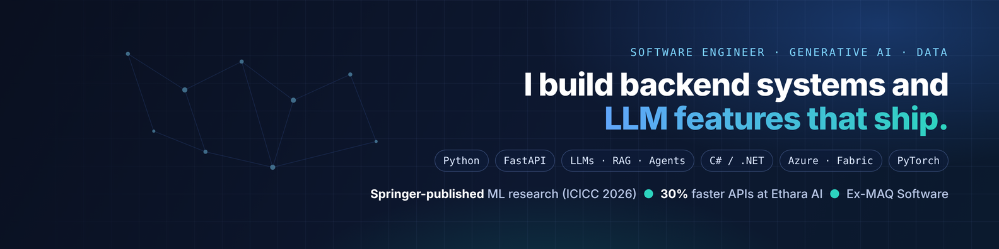

<h1 align="center">Hi, I'm Dev Kumar Dahiya</h1>

  <b>Software Engineer at Ethara AI</b> · Backend &amp; Generative AI · Gurugram, India
   
  <a href="https://potrfolio-puce.vercel.app">Portfolio</a> ·
  <a href="https://linkedin.com/in/devkumardahiya">LinkedIn</a> ·
  <a href="https://link.springer.com/chapter/10.1007/978-3-032-28594-2_9">Springer paper</a> ·
  <a href="mailto:devdahiya4002@gmail.com">devdahiya4002@gmail.com</a>

I build backend systems and LLM features that ship to real users. Before Ethara AI I worked on data engineering at **MAQ Software** and Generative AI document processing at **Horizon17**, and I co-authored a **Springer-published** paper on detecting AI-generated speech.

- **At Ethara AI:** 8 REST APIs and backend services bringing LLM features into production, API responses 30% faster through query tuning and caching, unit-test coverage raised to 80%
- **Research:** [Forensic Deepfake Audio Detection Using CNN-Attention Mechanism](https://link.springer.com/chapter/10.1007/978-3-032-28594-2_9), ICICC 2026 (Springer LNNS), 99.33% accuracy on 10,000 audio clips
- **Open to:** Software Engineer, AI/ML Engineer, Backend and Data Engineer roles, on-site, hybrid or remote

## Featured projects

| Project | What it does | Built with |
|---|---|---|
| [**PIE Job Agent**](https://github.com/Dev123dahiya/pie-job-agent) | Personal job-search agent: finds jobs, shortlists them with Claude against a verified profile, builds tailored resumes and prepares applications, with a dashboard and dry-run browser automation | FastAPI, SQLAlchemy, Claude API, Playwright, Next.js, TypeScript |
| [**Deepfake Audio Detection**](https://github.com/Dev123dahiya/deepfake-audio-detection) | CNN + BiLSTM + attention model that classifies speech as real or AI-generated, with training, evaluation and a FastAPI / Streamlit inference app (research co-authored and published at ICICC 2026) | Python, TensorFlow, librosa, FastAPI, Streamlit |
| [**OCR Bill Analyzer**](https://github.com/Dev123dahiya/Invoice_Parser) | Turns PDF bills and invoices into structured JSON using EasyOCR plus LLMs (Groq, Gemini), behind a FastAPI REST API | Python, FastAPI, EasyOCR, Gemini, Groq |
| [**OrbitX**](https://github.com/Dev123dahiya/OrbitX) | Batch document pipeline that detects invoices and contracts, extracts typed fields and summaries with an LLM, validates them and writes JSON | Python, OpenAI API, Pydantic, PyMuPDF |
| [**LLM Prompt &amp; Response Evaluator**](https://github.com/Dev123dahiya/prompt-response-evaluator) | REST API to submit prompts, attach model responses, score them automatically and track analytics over time | Django REST Framework, PostgreSQL, JWT, NumPy, Pandas |
| [**BIOMED XPERT CRM**](https://github.com/Dev123dahiya/biomed-xpert-crm) | Lead and sales tracker for a biomedical equipment business, with a six-stage pipeline and Excel, CSV and PDF exports | TypeScript, React, Express, Prisma, Docker |
| [**Leave Request Management**](https://github.com/Dev123dahiya/leave-management-system) | Full-stack leave requests and approvals with JWT login and role-based access | React, Express, MongoDB |
| [**Emotion-Based Music Recommender**](https://github.com/Dev123dahiya/emotion-based-music-recommender) | Reads your facial emotion from the webcam and recommends songs to match | Python, TensorFlow, OpenCV, Streamlit |

## Tech stack

## Experience

- **Software Engineer**, Ethara AI · May 2026 to present
- **Associate Software Engineer Intern**, MAQ Software · Nov 2025 to Feb 2026: ETL pipelines in Microsoft Fabric and Azure Data Factory over 1M records, 5 Power BI dashboards from 4 data sources, 10 backend APIs in C# and ASP.NET
- **Software Developer Intern**, Horizon17 · May to Jul 2025: OCR + LLM pipeline for 500 scanned invoices at 90% extraction accuracy, cutting manual data entry by 60%

B.Tech in Computer Science, Amity University (CGPA 8.60)
