  

  <a href="https://devkumardahiya.is-a.dev"><b>Portfolio</b></a> &nbsp;·&nbsp;
  <a href="https://www.linkedin.com/in/devkumardahiya">LinkedIn</a> &nbsp;·&nbsp;
  <a href="https://link.springer.com/chapter/10.1007/978-3-032-28594-2_9">Springer paper</a> &nbsp;·&nbsp;
  <a href="mailto:devdahiya4002@gmail.com">devdahiya4002@gmail.com</a>

I build backend services, data pipelines and LLM features, and I publish what I learn as working code. At **Ethara.ai** I ship REST APIs that bring LLM features into live products. Before that, data engineering on Microsoft Fabric at **MAQ Software** and a Generative AI document pipeline at **Horizon17**. I co-authored a **Springer-published** paper on detecting AI-generated speech.

**Open to** Software Engineer, AI/ML Engineer, Backend and Data Engineer roles, on-site, hybrid or remote.

---

## Engineering projects

Twenty repositories written from first principles. Every one has its own test suite and a GitHub Actions pipeline that runs on each push, and every README ends with a **Limits** section saying what the code does not do.

### Backend and distributed systems

| Project | What it does | Built with |
|---|---|---|
| [**Rate Limiter Lab**](https://github.com/Dev123dahiya/rate-limiter-lab) | Four rate-limiting algorithms behind one interface, ASGI middleware, and a benchmark showing which ones let bursts through | Python, ASGI, Token bucket |
| [**Distributed Job Queue**](https://github.com/Dev123dahiya/distributed-job-queue) | Durable background-job queue on SQLite: concurrent workers, retries with backoff, crash recovery, poison jobs | Python, SQLite, Idempotency |
| [**Event-Sourced Ledger**](https://github.com/Dev123dahiya/event-sourced-ledger) | Double-entry ledger where an append-only event log is the only source of truth; balances rebuild from the log | Python, SQLite, Event sourcing |
| [**URL Shortener Service**](https://github.com/Dev123dahiya/url-shortener-service) | The system-design answer actually built and measured: code generation, consistent-hash sharding, read cache | Python, Consistent hashing, LRU |
| [**Realtime Chat Server**](https://github.com/Dev123dahiya/realtime-chat-server) | WebSocket chat: rooms, presence, typing, history replay after a dropped connection, pub/sub across processes | TypeScript, Node.js, WebSockets |

### AI and LLM engineering

| Project | What it does | Built with |
|---|---|---|
| [**RAG Knowledge Assistant**](https://github.com/Dev123dahiya/rag-knowledge-assistant) | Retrieval-augmented answering: heading-aware chunking, BM25 and vector retrieval fused, answers that cite sources | Python, NumPy, BM25 |
| [**Vector Search Engine**](https://github.com/Dev123dahiya/vector-search-engine) | The HNSW index inside vector databases, written from scratch, with an exact baseline and a recall-versus-work benchmark | Python, NumPy, HNSW |
| [**Agent Tool Runtime**](https://github.com/Dev123dahiya/agent-tool-runtime) | A strict runtime for tool-using agents: validated calls, approval gates, step caps, and replayable traces | Python, Tool calling, Guardrails |
| [**LLM Gateway**](https://github.com/Dev123dahiya/llm-gateway) | One front door for several providers: fallback, circuit breakers, caching, PII masking, per-team budgets | Python, Circuit breaker, Caching |
| [**LLM Eval Harness**](https://github.com/Dev123dahiya/llm-eval-harness) | Evaluation with statistics attached: confidence intervals, a significance test, and a CI regression gate | Python, Bootstrap, McNemar test |

### Data engineering and ML

| Project | What it does | Built with |
|---|---|---|
| [**Mini SQL Engine**](https://github.com/Dev123dahiya/mini-sql-engine) | A SQL engine in pure Python: lexer, parser, a planner that picks indexes and joins, checked against SQLite | Python, Query planning, Indexes |
| [**Stream Windowing Engine**](https://github.com/Dev123dahiya/stream-windowing-engine) | Event-time windows over out-of-order streams: watermarks, corrections for late data, checkpointed state | Python, Watermarks, Checkpointing |
| [**DuckDB ELT Pipeline**](https://github.com/Dev123dahiya/duckdb-elt-pipeline) | Incremental ELT on DuckDB: raw landing, SQL modelling, quarantine for bad rows, and quality gates before the marts | Python, DuckDB, SQL |
| [**Churn ML Pipeline**](https://github.com/Dev123dahiya/churn-ml-pipeline) | What comes after model.fit: calibration, cost-based thresholds, a registry with a promotion gate, drift checks | scikit-learn, pandas, MLOps |
| [**Recommender Engine**](https://github.com/Dev123dahiya/recsys-engine) | Three implicit-feedback recommenders from scratch, with an offline evaluation that avoids fooling itself | Python, NumPy, ALS and kNN |

### Cloud, DevOps and security

| Project | What it does | Built with |
|---|---|---|
| [**Kubernetes Microservices Deploy**](https://github.com/Dev123dahiya/k8s-microservices-deploy) | Three services and a Helm chart; CI installs them on a real cluster and proves rolling restarts drop no requests | Kubernetes, Helm, GitHub Actions |
| [**Auth Service**](https://github.com/Dev123dahiya/auth-service) | Login from the standard library: scrypt, signed tokens, rotating refresh tokens with reuse detection, TOTP, RBAC | Python, JWT, TOTP |
| [**Observability Kit**](https://github.com/Dev123dahiya/observability-kit) | Metrics, distributed traces, structured logs and multi-window SLO burn-rate alerting, written from scratch | Python, Prometheus format, SLOs |
| [**Secret Scanner**](https://github.com/Dev123dahiya/secret-scanner) | Finds committed credentials and vulnerable dependencies; baselines for old findings, SARIF output, CI exit code | Python, Entropy, SARIF |
| [**Infra Policy Linter**](https://github.com/Dev123dahiya/infra-policy-linter) | Eighteen rules for Dockerfiles and Kubernetes manifests, with line numbers, suppressions and a CI gate | Python, Docker, Kubernetes |

## Applied projects

| Project | What it does | Built with |
|---|---|---|
| [**PIE Job Agent**](https://github.com/Dev123dahiya/pie-job-agent) | Job-search agent: pulls openings, shortlists them with Claude against a verified profile, builds tailored resumes | FastAPI, Claude API, Playwright |
| [**Deepfake Audio Detection**](https://github.com/Dev123dahiya/deepfake-audio-detection) | CNN + BiLSTM with attention that separates real speech from AI-generated, the code behind the Springer paper | Python, TensorFlow, librosa |
| [**OCR Bill Analyzer**](https://github.com/Dev123dahiya/Invoice_Parser) | Turns PDF bills and invoices into structured JSON: EasyOCR plus Groq and Gemini, behind a FastAPI API | Python, FastAPI, EasyOCR |
| [**OrbitX**](https://github.com/Dev123dahiya/OrbitX) | Batch document pipeline: spots invoices and contracts, extracts typed fields with an LLM, validates, writes JSON | Python, OpenAI API, Pydantic |
| [**LLM Prompt & Response Evaluator**](https://github.com/Dev123dahiya/prompt-response-evaluator) | REST API to submit prompts, score model responses automatically and track the results over time | Django REST, PostgreSQL, JWT |
| [**BIOMED XPERT CRM**](https://github.com/Dev123dahiya/biomed-xpert-crm) | Lead and sales tracker with a six-stage pipeline and Excel, CSV and PDF exports | TypeScript, React, Prisma |
| [**Malware Detection**](https://github.com/Dev123dahiya/Malware-Detection) | Classifies Windows executables by rendering file bytes as images and fine-tuning a ResNet-34 | Python, fastai, ResNet-34 |
| [**Test Drive Analytics Dashboard**](https://github.com/Dev123dahiya/crestwyn-test-drive-analytics-dashboard) | Multi-page BI dashboard over a year of test drives: consultant performance, satisfaction, conversion | Analytics, Data visualization |

Every project is on the [portfolio](https://devkumardahiya.is-a.dev) with a screenshot or its real output.

---

## Experience

| Role | Where | When | What I did |
|---|---|---|---|
| **Software Developer** | [Ethara.ai](https://www.ethara.ai/) | May 2026 – now | 8 REST APIs and backend services that add LLM features to live products; responses 30% faster through query tuning and caching; unit-test coverage raised to 80% |
| **Associate Software Engineer Intern** | [MAQ Software](https://maqsoftware.com/) | Nov 2025 – Feb 2026 | ETL pipelines in Microsoft Fabric and Azure Data Factory over a million records; 5 Power BI dashboards from 4 sources; 10 backend APIs in C# and ASP.NET |
| **AI Intern** | [Horizon17](https://www.horizon17ww.com/) | May – Jul 2025 | OCR and LLM pipeline reading 500 scanned invoices at 90% extraction accuracy and estimating the carbon emissions behind each one, cutting manual data entry by 60% |

## Research

**[Forensic Deepfake Audio Detection Using CNN-Attention Mechanism](https://link.springer.com/chapter/10.1007/978-3-032-28594-2_9)**  
ICICC 2026, Springer Lecture Notes in Networks and Systems. A CNN + BiLSTM model with attention over MFCC and Mel-spectrogram features, reaching 99.33% accuracy on 10,000 audio clips across accents. [Code](https://github.com/Dev123dahiya/deepfake-audio-detection)

## What I work with

| | |
|---|---|
| **Languages** | Python · TypeScript · JavaScript · C# · SQL · Go · Java · C++ |
| **Backend** | FastAPI · Django REST Framework · ASP.NET Core · Node.js · Express · REST APIs · JWT |
| **AI and LLMs** | Claude, OpenAI, Groq and Gemini APIs · RAG · agents and tool calling · evaluation harnesses · PyTorch · TensorFlow · OpenCV · OCR |
| **Data** | PostgreSQL · MongoDB · DuckDB · SQLite · Microsoft Fabric · Azure Data Factory · pandas · PySpark · Power BI |
| **Cloud and DevOps** | Docker · Kubernetes · Helm · GitHub Actions · Microsoft Azure · Vercel · Render |
| **How I work** | Tests alongside the code · CI on every repository · benchmarks over claims · SLOs and observability |

## Education

**B.Tech in Computer Science**, Amity University Noida, 2022 – 2026, CGPA 8.60.  
Microsoft Certified: Fabric Data Engineer Associate (DP-700) · Oracle Database certification · IBM Cybersecurity Fundamentals.

